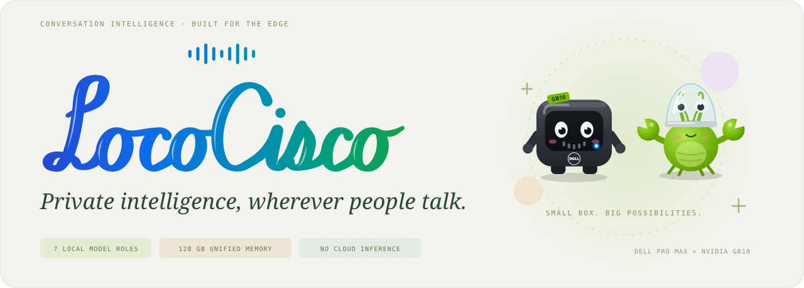
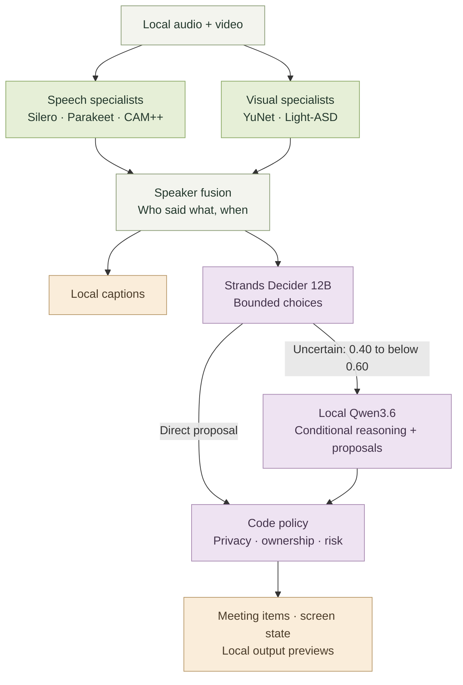

<p align="center">
  
</p>

<p align="center">
  <strong>Local first. Privacy driven. No wake word.</strong><br>
  Conversation intelligence on a Dell Pro Max with NVIDIA GB10.
</p>

<p align="center">
  <a href="https://naichuanzhang.github.io/LocoCisco/">Open the live slides</a> ·
  <a href="Presentation/README.md">Explore the presentation</a> ·
  <a href="docs/BROWSER_DEMO.md">Run the demo</a> ·
  <a href="BUILD_SPEC.md">Read the build spec</a> ·
  <a href="Presentation/assets/logo/index.html">Logo &amp; avatars source</a>
</p>

---

## Your conversations. Your intelligence.

**LocoCisco is a local-first, privacy-driven smart-office prototype.** It turns
conversation into transcripts, proposed tasks and decisions, and grounded local
answers. Speech models, computer vision, a bounded Decider, and a language model
work together on an edge box in the room.

The ambition: offer a private, affordable alternative to traditional Cisco-style
room hardware, with intelligence that stays close to the people using it. The
current build starts with a meeting assistant; the wider opportunity is any
place where people talk and confidentiality matters.

| Keep it local | Make conversation useful | See how it works |
| :--- | :--- | :--- |
| Audio, video, and model inference stay on the prepared Dell box. No cloud inference or cloud fallback in the meeting demo. | Capture who said what, propose follow-ups, and ask questions against retained meeting context. | Inspect model observations, decision routes, and policy outcomes. Switch off-record when a conversation becomes private. |

## Where it fits

| Horizon | Who it serves | The opportunity |
| :--- | :--- | :--- |
| **Near term → businesses** | Teams handling confidential interpersonal communication | HR conversations, legal and financial consultations, client meetings, and patient or customer discussions where sending audio elsewhere is a concern. |
| **Near term → government** | Agencies and public-service teams | Citizen services, casework, interviews, and internal or inter-agency briefings with local control over conversation data. |
| **Long term → the private smart home** | Households that want helpful ambient intelligence | A local hub for voice, routines, lighting, and comfort—without sending household audio to big tech. |

**The commercial direction:** an edge appliance plus software, deployment, and
support. Start with one room or service point; expand after proving useful
follow-through and workable privacy controls. Lower operating costs and replacing
traditional room hardware are product goals; savings and replacement compatibility
have not yet been validated.

## From conversation to follow-through

1. **Listen and look.** Speech detection, transcription, voice labels, and visual
   speaking evidence describe the conversation.
2. **Connect the evidence.** Speaker fusion associates words with anonymous voices
   and supported face tracks. Names require a spoken or manual check-in.
3. **Decide when to help.** The Decider makes bounded, scored choices. Uncertain
   cases can reach local Qwen for richer interpretation and tool proposals.
4. **Check before acting.** Deterministic policy accepts, asks for review, denies,
   or ignores proposals before meeting items and local output previews change.



Captions follow perception directly; they do not wait for a language-model decision.
All inference in this demo runs locally.

## Seven model roles. One Dell box.

The **Dell Pro Max with NVIDIA GB10 and 128 GB unified memory** hosts the stack.
Small sensing models use the CPU; speech recognition, audiovisual scoring, and
language models use the GPU. Qwen is called conditionally, so every utterance
does not require a full generative response.

| Model | Placement | Job and reason for the choice |
| :--- | :--- | :--- |
| **Silero VAD v5** | CPU · ONNX | Finds speech and cuts at pauses, giving downstream models bounded audio segments. |
| **Parakeet TDT 0.6B v3 · Q8** | GPU · NeMo-Speech.cpp | Produces words and timestamps. Parakeet was selected through the project's transcription comparison; this deployment uses the local Q8 speech service. |
| **WeSpeaker CAM++** | CPU · ONNX | Produces voice embeddings for session-only anonymous labels. Windowed labeling performed better than the earlier per-segment approach in the project evaluation. |
| **YuNet 2023mar** | CPU · OpenCV | Detects and tracks faces, giving active-speaker analysis face regions to inspect. It does not recognize identities. |
| **Light-ASD · AVA** | GPU · PyTorch | Combines audio with face motion to score who appears to be speaking. It replaced a motion-only heuristic after evaluation. |
| **Strands Decider 12B** | Local GPU service | Answers bounded questions about intent, owner, and sensitivity. Structured choices make the initial decision route inspectable. |
| **Qwen3.6 35B-A3B · NVFP4** | GPU · vLLM | Reuses the box's local language-model service for uncertain cases, tool proposals, and grounded answers to local questions. |

See the [model registry](config/models.toml),
[model-selection experiments](docs/TRANSCRIBE.md), and
[backend validation](docs/reports/BACKEND_VALIDATION.md) for configuration and evidence.
The browser demo disables TTS, whiteboard VLM, and the optional second Decider.

<details>
<summary><strong>Inside the decision route</strong></summary>

| Decider action confidence | Normal route |
| :--- | :--- |
| **At least 0.60** | Send the proposal directly to policy. |
| **0.40 to below 0.60** | Ask local Qwen when escalation is enabled. |
| **Below 0.40** | Send the low-confidence result to policy, which normally ignores it. |

These scores control routing; they are not calibrated accuracy guarantees. A
confident `none` still means no action, and policy can deny a model's proposal.

</details>

## Take it for a spin

### The presentation · no models required

**[Open the hosted presentation](https://naichuanzhang.github.io/LocoCisco/)**,
or run it locally:

Five light-themed HTML slides with playful animations, a two-minute demo-video
slot, the model story, and business-to-home use cases. From the repository root:

```bash
python3 -m http.server 8890 --bind 127.0.0.1
```

Open **http://127.0.0.1:8890/Presentation/**. The
[presentation guide](Presentation/README.md) covers controls and video setup;
[presenter notes](Presentation/PRESENTER_NOTES.md) explain each build.

### The working demo · prepared Dell hardware

The recording view puts video, captions, model activity, decision scores, and
meeting items on one canvas. It processes a local video through the real models;
no USB microphone or webcam is needed for this demo.

```bash
export UNSPOKEN_LOCAL_API_KEY_FILE="$HOME/.nemoclaw/dual-station-vllm-api-key"
deploy/demo/up.sh
```

Open **http://127.0.0.1:8780/**, or append `?autoplay=0` to prepare an idle take.
The environment variable points to a credential file. Startup reuses the staged
offline model kit and existing local services; it does not install packages or
download weights. Follow the [browser demo guide](docs/BROWSER_DEMO.md) for
preparation, recording, and privacy controls.

<details>
<summary><strong>What the current demo demonstrates</strong></summary>

- **Real local inference:** the bundled [Demo.mp4](Presentation/Demo.mp4) is
  30.08 seconds of input footage, separate from the presentation's two-minute
  demo slot. Names, translations, and graphics baked into it are source content;
  the surrounding dashboard's captions and model traces are computed locally.
- **Verified recording workflow:** replay, recording layout, and privacy
  masking/muting have been checked. Final native capture quality and bilingual
  transcription/intent accuracy still need evaluation.
- **Local output previews:** device actions and Discord notifications are
  rehearsed locally. Real delivery requires separate integration work.
- **Explicit privacy controls:** off-record masks the source image, mutes captured
  audio, and discards protected text and delayed inference. It cannot erase
  original input files or earlier recordings and exports.

The [build specification](BUILD_SPEC.md) separates implemented behavior,
completed validation, and remaining acceptance criteria.

</details>

## Explore the project

| Path | What's inside |
| :--- | :--- |
| [unspoken/](unspoken/) | Application, meeting runtime, perception, policy, and browser UI. `unspoken` remains the package and deployment compatibility name. |
| [deploy/demo/](deploy/demo/) | Prepared Dell demo launcher and local media tooling. |
| [config/models.toml](config/models.toml) | Central model-role and deployment-profile registry. |
| [Presentation/](Presentation/) | Animated HTML deck, presenter notes, video input, and logo/avatars. |
| [docs/](docs/) | Setup guides, evaluation reports, and architecture notes. |
| [tests/](tests/) | Automated checks for application behavior and deployment. |
| [design-reference/](design-reference/) | Visual references and dashboards with scripted example data. |
| [homedemo/](homedemo/) | Earlier smart-home prototype, including optional legacy cloud paths; separate from the current local meeting demo. |

Large model weights, credentials, and generated recordings stay outside Git.
Small licensed model assets and test fixtures are included; see
[source provenance and dependency notices](docs/SOURCE_PROVENANCE.md).

---

<p align="center">
  Built with curiosity, a Dell box, and a lot of local inference.<br>
  <strong>Thanks to Dell, NVIDIA, and the hackathon sponsors for making it possible.</strong><br><br>
  <em>At work. In public service. Eventually, at home.</em>
</p>
