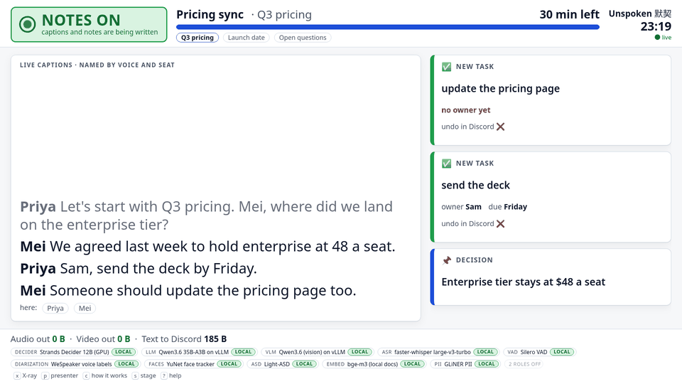
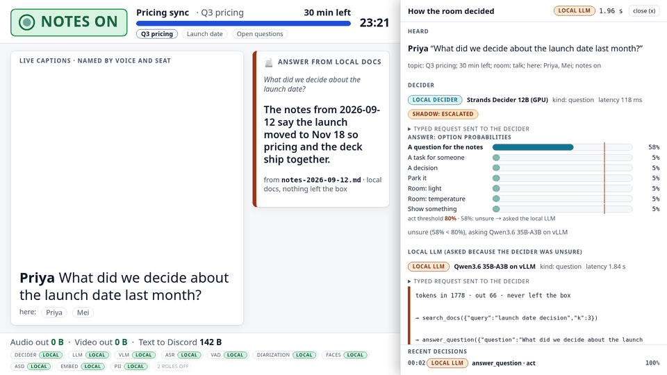
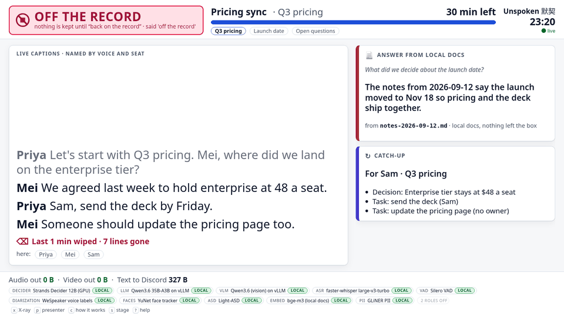

# The room screen (`unspoken/meeting/web`)

The full-screen page on the meeting-room TV: the GB10's HDMI out, a kiosk browser pointed at
`http://127.0.0.1:8780/`. Readable from 3 m, and the judges' demo view. Vanilla HTML/CSS/JS, nothing
vendored from a CDN, no network request except to its own server.



## Run it

```bash
# against the fake runtime (no models, no hardware): plays the 3-minute demo story on request
.venv/bin/python -m unspoken.meeting.web.dev_fake --port 18751
.venv/bin/python -m unspoken.meeting.web.dev_fake --port 18751 --speed 4 --autoplay demo_story
# open http://127.0.0.1:18751/  (presenter layout: ?present=1, force a theme: ?theme=dark|light, X-ray open: ?xray=1)

# inside the real runtime (meeting workstream wires this):
from unspoken.meeting.web import create_app, serve_async
app = create_app(runtime)            # BEFORE runtime starts its agents: the stream hub subscribes to the bus here
await serve_async(runtime, "127.0.0.1", 8780, app=app)
```

`serve()` / `serve_async()` refuse any host that is not loopback (`require_loopback`). There is **no
authentication by design**: the page is reachable from this machine only (the kiosk browser, or an
`ssh -L` tunnel the operator opened). Do not put it behind a reverse proxy.

## What is on the page

| Area | Shows | Source |
|---|---|---|
| Privacy state (top left, big) | **NOTES ON** (green, ● icon) / **PAUSED** (amber, ❚❚) / **OFF THE RECORD** (red, ⦸). Always text + icon, never colour alone. Matches the lamp scene (`talk` / `privacy` / `off_record`) | `snapshot.privacy`, `meeting.privacy` |
| Captions | Last `settings.caption_lines` (6) lines, bold speaker name, `Guest` for a voice with no check-in. Off-record lines are gone (the runtime never sends them); a red "Last 1 min wiped · N lines gone" note shows while off the record | `screen.state.captions`, `meeting.privacy.wiped_count` |
| Agenda | Title, topic, minutes left, timer bar (turns amber at 2 min), topic chips | `screen.state.agenda`, `meeting.status` |
| Banner | e.g. "2 min left. 1 task has no owner." or "Guest in the room · local docs hidden" | `screen.state.banner` |
| Cards | `task` (owner, due, "undo in Discord ❌", amber "no owner yet"), `decision`, `answer` (text + doc name), `catch_up` (for a late joiner), `approval`, `posted`, `tasks` | `screen.state.cards` |
| Egress meter | "Audio out 0 B · Video out 0 B · Text to Discord N B" | `snapshot.egress`, `egress.meter` |
| Model badges | every enabled role: ROLE · label · **LOCAL** (REMOTE in red if a target is off-box, DOWN if `ok` is false), "N roles off" | `GET /api/models` |
| Decider X-ray (key `x`) | what was heard, the exact typed request (state + questions, type badges `choice` / `yes/no`), option probabilities as bars against the act threshold, route badge **LOCAL DECIDER** / **LOCAL LLM** / **RULE** / **USER**, latency stopwatch, policy verdict, and for escalations the local LLM's tokens, tool calls and reply; last 8 decisions | `meeting.utterance`, `meeting.proposal`, `meeting.verdict` |




### Keys

`x` X-ray · `p` presenter mode (projector layout, captions as an overlay; also `?present=1`) · `c` "how
it works" card (sensors → decider → LLM only when unsure → policy → devices / Discord; nothing but text
leaves the box) · `s` stage controls (scenarios, reset, inject a Discord command; rehearsal only) · `t`
light/dark · `?` help · `Esc` closes everything. The footer lists them.

### Accessibility

High contrast in light and dark (`prefers-color-scheme`, forced with `?theme=`), `prefers-contrast: more`
thickens lines, `prefers-reduced-motion` turns every animation and transition off. Captions are an
`aria-live="polite"` list; the privacy block is `role="status" aria-live="assertive"`; the banner and cards
are polite live regions. Type scales with the viewport (`rem = clamp(15px, 1.1vw, 26px)`): 1920×1080 and
1280×720 both work, and captions are 1.9 rem (≈40 px at 1080p; 2.5 rem in presenter mode).

## API (JSON, loopback only)

| Route | Does |
|---|---|
| `GET /` | the page |
| `GET /api/snapshot` | `{"snapshot": runtime.snapshot(), "settings": MeetingSettings}` |
| `GET /api/models` | `{"models": [RoleHealth + "local": bool], "all_local": bool}`; `local` = in-process, model path, or a URL whose host is loopback / RFC 1918 / link-local / `.local` |
| `WS /ws` | first frame `ui.snapshot` `{snapshot, settings}`, then bus events on `screen.state`, `meeting.*`, `egress.meter`, `trace.log`, `scenario.status`, `room.env`, `video.scene` (never `audio.segment` / `video.speakers`), throttled `ui.snapshot` after state changes, `ui.settings` after a settings change, `ui.ping` every 15 s |
| `GET /api/scenarios` | `runtime.scenarios()` |
| `POST /api/scenario/{id}` | run one (404 if unknown) |
| `POST /api/stop` / `POST /api/reset` | stop the scenario / stop + reset the runtime |
| `POST /api/chat` | inject a Discord command: `{"command": "here"\|"offrecord"\|"resume"\|"recap"\|"agenda"\|"undo"\|"approve"\|"deny"\|"ask", "user", "args", "text"}` → `{"ok", "text"}` |
| `POST /api/settings` | any of `act_threshold`, `ask_threshold`, `escalate`, `wipe_seconds`, `caption_lines`, `speed` (validated; `ask_threshold ≤ act_threshold`; `mode` is not settable here) |

The stream hub keeps one bounded queue (500) per client and drops the oldest frame for a slow client; the
page re-renders from the next `ui.snapshot`, so a dropped frame is never visible for long. The page
reconnects with backoff and shows "○ reconnecting" top right.

## The fake runtime (`dev_fake.py`)

`FakeMeetingRuntime` implements `MeetingRuntimeAPI` on canned data and plays scenarios written in the
contract's scenario DSL (`start`, `join`, `say`, `media_say`, `enter`, `leave`, `scene`, `chat`, `clock`,
`end`, `wait`, `note`, `expect`). Every step publishes the same events the real pipeline does
(`meeting.utterance` → `meeting.proposal` with X-ray fields → `meeting.verdict` → `meeting.command` /
`meeting.item` / `room.env` / `egress.meter` → `screen.state`), with the decider at 118 ms and the local
LLM at 1.84 s. `demo_story` is the 3-minute story; `beat_*` are its parts. `fast=True` (tests) skips
every sleep. Model labels in the fake are placeholders shaped like `RoleHealth`; the real page shows
whatever the registry reports.

## Privacy

Nothing on the page is a raw observation: the server never streams `audio.segment` or `video.speakers`,
and the fake drops a line said off the record before it reaches the bus (only the words "off the record"
of the trigger sentence are kept, the rest is replaced by `[…]`). The X-ray shows token counts to prove
the LLM was or was not called; the tokens themselves never leave the box.
